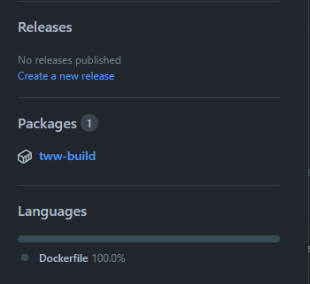
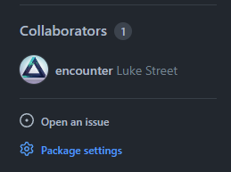
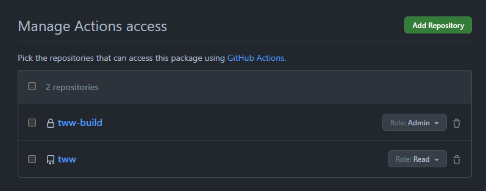

# GitHub Actions

[`.github/workflows/build.yml`](/.github/workflows/build.yml) builds `GVLE69` on every push to main and pull request, fails if `main.dol` stops matching, and uploads the `report.json` progress report as an artifact. It needs a private build container holding the original `main.dol`, set up once as below.

The workflow also builds the [decomp-toolkit fork](https://github.com/Esoteric-Engineer/mnroi-decomp-toolkit) from source (`DTK_REF` at the top of `build.yml`, `main` by default). The result is cached by fork commit, so it only recompiles after the fork changes.

- [Build Repository](#build-repository)
- [Workflow](#workflow)

## Build Repository

This repository will be used to build and store the CI build container.

> [!CAUTION]
> This repository should be **private** to avoid exposing the game's assets.

1. [Create a **private** repository from `encounter/dtk-template-build`](https://github.com/new?template_name=dtk-template-build&template_owner=encounter) named `mnroi-build`.

2. Once the repository is created, add `orig/GVLE69/sys/main.dol`. **That is the only game file the build reads**; don't add anything else from the disc.

    The image also bakes in the binutils and compilers versions pinned in `configure.py` (`binutils_tag`, `compilers_tag`), and CI uses those instead of downloading them. When you bump either tag, update `mnroi-build`'s `Dockerfile` to match.

3. Once the build container action completes, visit the package settings:  
      
    

4. Under "Manage Actions access", add your project's main repository with the "Read" role:  
    

## Workflow

Nothing to set up beyond the build container. Once the image exists and `mnroi` can read it, the next push runs the build and the README's Build Status badge turns green.

On each push to main, the `progress` job turns `report.json` into three [shields.io endpoint](https://shields.io/badges/endpoint-badge) files (code, functions, data) via [`tools/progress_badges.py`](/tools/progress_badges.py) and force-pushes them to a single-commit `progress` branch. The README's progress badges read from there. Pull requests don't publish, and the branch needs no setup: the job creates it, using the workflow's `GITHUB_TOKEN`.

To build against a particular fork commit or tag instead of the fork's `main`, change `DTK_REF` in `build.yml`.
